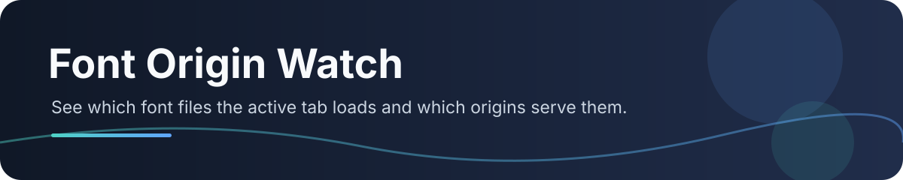

# Font Origin Watch ✨

> See which font files the active tab loads and which origins serve them.

  

## 🎯 Why this project?

See which font files the active tab loads and which origins serve them. It focuses on a narrow operational problem and keeps its output inspectable, deterministic, and suitable for scripts or CI.

## 🚀 Features

- 🧭 Solves the documented use case without a hosted service.
- 🧪 Includes repeatable tests and a runnable example.
- 📄 Supports concise human-readable output; machine-readable output is available where documented.
- 🔒 Avoids changing the target system during inspection.

## ⚡ Quick Start

1. Open `chrome://extensions` and enable **Developer mode**.
2. Choose **Load unpacked** and select this repository folder.
3. Visit a page, then open the extension popup to inspect font origins.

## 🖥️ Example

The popup lists each font URL, its origin, and whether that origin is same-site or third-party relative to the active page.

## 🔐 Permissions & privacy

The extension requests `webRequest`, `storage`, `tabs`, and `<all_urls>` host access so it can observe font requests across pages. It records URL, status code, and timestamp in session storage for the active tab. It does not block, rewrite, or transmit requests to a remote service.

## 🗺️ Roadmap

- Add Firefox-specific packaging after validating API differences.
- Add export of a tab's font inventory as JSON.
- Add a per-site allowlist without blocking network requests.

## 🤝 Contributing

See [CONTRIBUTING.md](CONTRIBUTING.md). Bug reports should include the command, a minimal input fixture, and the observed output. Please do not attach credentials or private production data.

## 📜 License

MIT — see [LICENSE](LICENSE).
